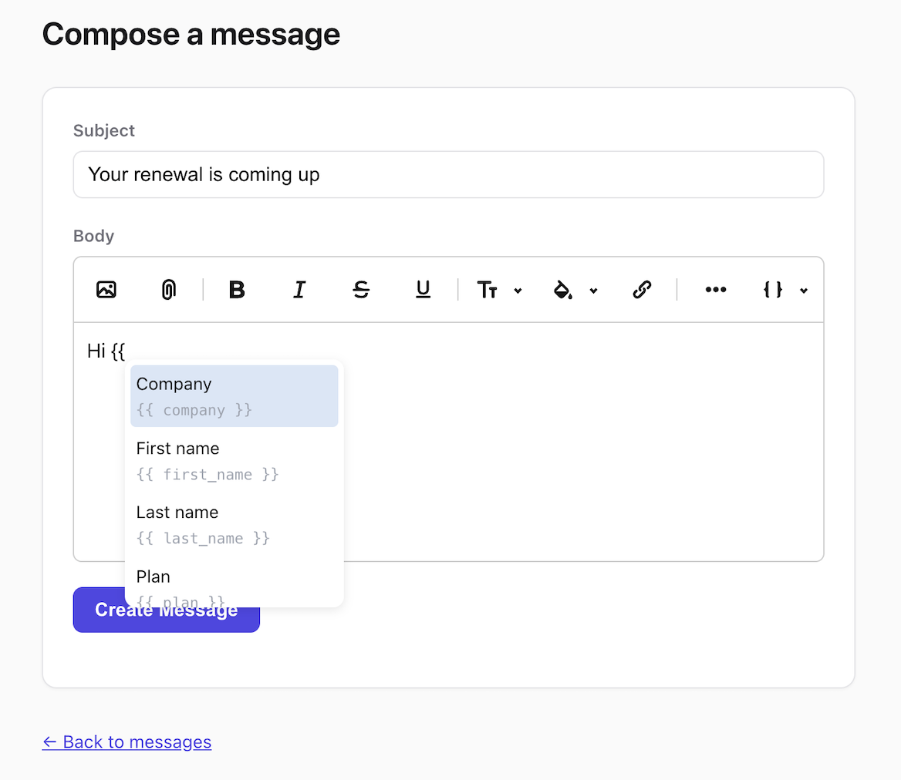
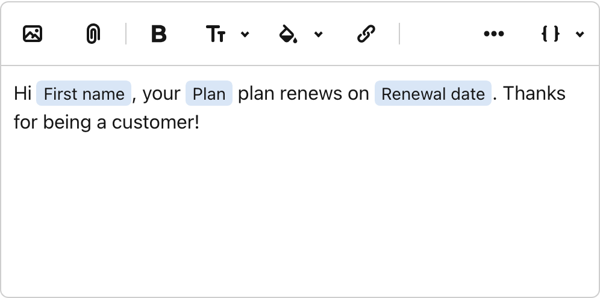
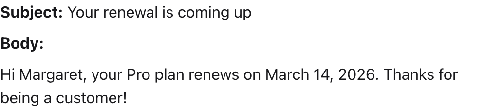
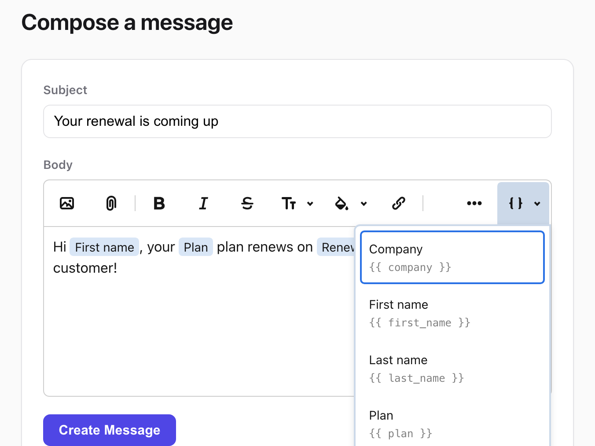

# lexxy-variables

Insert and safely resolve variables in [Lexxy](https://github.com/basecamp/lexxy)
rich text. The gem gives you an editor button (and a `{{` prompt) for inserting
variables into your text. Each variable is stored as an [Action Text
attachment](https://guides.rubyonrails.org/action_text_overview.html#rendering-attachments),
an `<action-text-attachment>` chip with its own content type, not as literal
`{{ var_name }}` markup. At render time the gem resolves each chip to its `value`.
You decide what variables exist and what they turn into.

Because variables are just Action Text attachments, you can register new
chip types with `register_attachment` (see [Full configuration](#full-configuration)).
A `:text` chip resolves to an escaped string. An `:html` chip splices rich
content in before sanitization.

Liquid is **optional**. The default renderer is plain, injection-safe string
substitution and pulls in no template engine.

<p align="center">
  
</p>

## Requirements

Ruby 3.2+, Rails 8.0+, and Lexxy 1.0+. Works with
importmap-rails or any JavaScript bundler (esbuild, vite, webpack).

## Install

Ruby:

```ruby
# Gemfile
gem "lexxy-variables"
```

Then wire up the JavaScript, either via importmap or a bundler.

**importmap-rails.** Install Lexxy per [its docs](https://basecamp.github.io/lexxy/docs/)
(`pin "lexxy", to: "lexxy.js"`). The engine pins `lexxy-variables` and
`@37signals/lexxy` for you, so the only step left is registering the extension
in your entrypoint:

```js
// app/javascript/application.js
import * as Lexxy from "lexxy"
import VariableExtension from "lexxy-variables"

Lexxy.configure({ global: { extensions: [ VariableExtension ] } })
```

**Bundler (esbuild, vite, webpack).** The extension is also distributed as an
npm package. Install it alongside Lexxy:

```sh
yarn add @37signals/lexxy lexxy-variables
```

and register the extension in your JavaScript.

```js
// app/javascript/application.js
import * as Lexxy from "@37signals/lexxy"
import VariableExtension from "lexxy-variables"

Lexxy.configure({ global: { extensions: [ VariableExtension ] } })
```

## Minimal configuration

`catalog` is the list users pick from in the editor. `assigns` is the lookup that
turns a key into a value at render time. `catalog` is required and `assigns` is
optional. Leave it out and the gem reads `value` straight off the catalog item,
or supply values per render (see [Examples](#examples)).

Put the `configure` block in an initializer, e.g. `config/initializers/lexxy_variables.rb`:

```ruby
LexxyVariables.configure do |c|
  c.catalog = [ { key: "company", name: "Company", value: "Acme" } ]
end
```

On the **editor page** (the form where content is composed), render the prompt
*inside* the Lexxy editor. The editor extension looks for the `<lexxy-prompt>`
within the `<lexxy-editor>` element, so it must be nested in the `rich_text_area`
block. That is what feeds the `{{` popup and the toolbar dropdown:

```erb
<%= form_with model: @record do |form| %>
  <%= form.rich_text_area :body do %>
    <%= lexxy_variables_prompt %>
  <% end %>
  <%= form.submit %>
<% end %>
```

Typing `{{` opens the prompt shown above, and there's also a toolbar dropdown
for picking from the same list. Inserted variables appear as chips in the editor:

<p align="center">
  
</p>

On the **display page** (where the saved content is shown to readers), resolve
the stored rich text with `with_variables`. This is what swaps each variable
chip for its value:

```erb
<%= @record.body.with_variables %>
```

Each chip resolves to its value, so the reader sees finished text:

<p align="center">
  
</p>

`@record` and `:body` are placeholders. Use whatever model and Action Text
attribute hold your content.

## Examples

### Simple replacement from a model

First and last name variables, with the values supplied at render time. No Liquid needed. The `catalog` lists the two variables so they appear in the editor:

```ruby
# config/initializers/lexxy_variables.rb
LexxyVariables.configure do |c|
  c.catalog = [
    { key: "first_name", name: "First name" },
    { key: "last_name",  name: "Last name" }
  ]
end
```

Editor page:

```erb
<%= form_with model: @message do |form| %>
  <%= form.rich_text_area :body do %>
    <%= lexxy_variables_prompt %>
  <% end %>
  <%= form.submit %>
<% end %>
```

Display page:

```erb
<%= @message.body.with_variables(
      first_name: @user.first_name,
      last_name:  @user.last_name) %>
```

The catalog entries have no `value` because it's supplied at render time, so the same saved content renders differently per user. Values are escaped for HTML automatically. When a variable name would collide with `context:` or `locale:`, use an `assigns:` hash instead:

```erb
<%= @message.body.with_variables(assigns: { locale: @user.locale }) %>
```

### Static values from config

When a value is the same for everyone, it can live on the catalog item itself. With no `assigns` set, the gem reads `value` off the catalog and `with_variables` takes no arguments:

```ruby
LexxyVariables.configure do |c|
  c.catalog = [ { key: "company", name: "Company", value: "Acme" } ]
end
```

```erb
<%= @message.body.with_variables %>
```

### Liquid drops and dotted access

Liquid enables dotted access like `{{ user.first_name }}`, filters, and drops that expose a whole object. A drop is a small class that defines which methods Liquid can call:

```ruby
# app/drops/user_drop.rb
class UserDrop < Liquid::Drop
  def initialize(user) = @user = user

  def first_name = @user.first_name
  def full_name  = @user.full_name
  def email      = @user.email
end
```

The dotted keys go in the catalog, the Liquid renderer is used, and `assigns` returns the drop under the name the keys use (`user`):

```ruby
LexxyVariables.configure do |c|
  c.catalog = [
    { key: "user.first_name", name: "First name" },
    { key: "user.full_name",  name: "Full name" },
    { key: "user.email",      name: "Email" }
  ]

  c.renderer = LexxyVariables::Renderers::Liquid.new

  c.assigns = ->(_used_keys) { { "user" => UserDrop.new(Current.user) } }
end
```

```erb
<%= @message.body.with_variables %>
```

A `user.first_name` chip becomes `{{ user.first_name }}`, which Liquid runs through the drop. Liquid can only call the methods the drop defines. Return raw values and let the gem handle the escaping.

## Plain text and Markdown

`with_variables` returns a plain `ActionText::Content` with every chip
resolved, so Action Text's own conversions chain from it:

```ruby
@message.body.with_variables(first_name: @user.first_name).to_plain_text
# => "Hi Ada, welcome aboard!"

@message.body.with_variables(first_name: "Ada").to_markdown # Rails 8.2+
```

Each format handles its own escaping. Values come out raw in `to_plain_text`
and `to_markdown`, and escaped in HTML. No view is required, so it works in
mailers (the text part of an email), background jobs, and exports:

```ruby
mail.text_part = @message.body.with_variables(assigns).to_plain_text
```

Rendering works the same as on any rich text body. During a request Rails
renders it with the current controller, so helpers and URLs resolve as usual.
Outside a request it uses Rails' offline renderer.

## Locales

`with_variables` takes a `locale:`. Resolution runs inside `I18n.with_locale`,
so anything that calls `I18n.t` along the way (assigns, resolvers, drops) sees
that locale. Leave it off to use the current locale. The previous locale is
restored afterward.

```ruby
@message.body.with_variables(locale: recipient.locale).to_plain_text
```

`with_variables` resolves right away, but the conversion you chain on it runs
later under whatever locale is current then. If the content has attachments
with translated partials, wrap the conversion too:

```ruby
resolved = @message.body.with_variables(locale: :fr)
I18n.with_locale(:fr) { resolved.to_s }
```

## Full configuration

`context` is yours to define. The gem passes it untouched to your catalog, assigns, and resolve callables, so put whatever they need in it. That might be a tenant, `nil`, or any object.

```ruby
LexxyVariables.configure do |c|
  # What users can insert. The {{ prompt and the toolbar dropdown read this.
  c.catalog = ->(context) { context.variables + BuiltinVariable.all }

  # What each used key resolves to at render time.
  c.assigns = ->(context, used_keys) { MyResolver.assigns(context, used_keys) }

  # Opt into Liquid for dotted access, drops, and filters.
  c.renderer = LexxyVariables::Renderers::Liquid.new

  # A second chip type. Snippets expand to rich HTML instead of an escaped value.
  c.register_attachment(
    content_type: "application/vnd.actiontext.snippet",
    renders_as: :html,
    label: "Snippet", # shown as a badge in the prompt when the list mixes types
    resolve: ->(node, context) { MySnippets.content_for(node, context) }
  )
end
```

### All options

| Option | Default | What it does |
| --- | --- | --- |
| `catalog` | `[]` | The insertable items shown in the `{{` prompt and the toolbar dropdown. A list, a zero-arg lambda, or a `->(context)` lambda. Items respond to `#key` and `#name`, and optionally `#value` and `#attachable_sgid`. |
| `assigns` | reads `#value` off catalog items | The render-time lookup. A `->(context, used_keys)` or `->(used_keys)` lambda that receives only the keys used in the content being rendered and returns a `{ key => value }` hash. Per-render values can also be passed straight to `with_variables` (see [Examples](#examples)). |
| `renderer` | `Renderers::Substitution.new` | How a chip's key becomes a value. The default is a plain hash lookup with no template engine. Swap in `Renderers::Liquid.new` for dotted access, drops, and filters. |
| `sort` | `:name` | How the catalog is ordered in the prompt and dropdown. `:name` (case-insensitive alphabetical), `:key`, `false` to keep the catalog's given order, or a lambda (a `->(item)` sort key or a `->(a, b)` comparator). |
| `max_fragment_depth` | `1` | How many levels of `renders_as: :html` chips expand. The default resolves the variables inside a snippet but drops a snippet nested inside another snippet. Raise it to allow deeper nesting. |
| `register_attachment(content_type:, resolve:, renders_as:, label:)` | variable type pre-registered | Adds or replaces a chip type. `renders_as:` is `:text` (default, the resolver returns a key whose value is substituted in as inert text) or `:html` (splices rich HTML in pre-sanitize, resolving inner `:text` chips in the same pass, bounded by `max_fragment_depth`). `label:` is the badge shown in the prompt when the list mixes types. Re-registering a content type (including the built-in variable type) replaces it, which is how you'd swap in a custom variable resolver. |

### Prompt options

`lexxy_variables_prompt` takes `context:` (see [Multi-tenancy](#multi-tenancy))
and lets you change the trigger characters and the empty state:

```erb
<%= lexxy_variables_prompt(trigger: "%%", empty_results: t(".no_variables")) %>
```

## Multi-tenancy

Tenancy is optional. If your app is multi-tenant, pass the tenant through as
`context`. With [acts_as_tenant](https://github.com/ErwinM/acts_as_tenant) that
looks like:

```ruby
LexxyVariables.configure do |c|
  c.catalog = ->(tenant) { tenant.variables }
end
```

Pass the tenant on the editor page:

```erb
<%= form.rich_text_area :body do %>
  <%= lexxy_variables_prompt(context: ActsAsTenant.current_tenant) %>
<% end %>
```

and again on the display page:

```erb
<%= @record.body.with_variables(context: ActsAsTenant.current_tenant) %>
```

Or skip `context` entirely and rely on acts_as_tenant scoping queries to the
current tenant for you:

```ruby
LexxyVariables.configure do |c|
  c.catalog = -> { Variable.all }  # already scoped to ActsAsTenant.current_tenant
  c.assigns = ->(keys) { Variable.where(key: keys).pluck(:key, :value).to_h }
end
```

## Styling

The gem ships a stylesheet for the chips, the toolbar dropdown and the `{{`
prompt. Import it once.

```css
/* bundlers (esbuild, vite): */
@import "lexxy-variables/styles";
```

```erb
<%# importmap / asset-pipeline hosts: the engine puts the vendored CSS on the
    asset path, so link it (or @import "lexxy_variables.css" from your CSS) %>
<%= stylesheet_link_tag "lexxy_variables" %>
```

It's built on Lexxy's own `--lexxy-*` variables, so it follows your Lexxy
theme with no setup. If you've changed Lexxy's colors, fonts or radius, the
variables UI already matches.

<p align="center">
  
</p>

### Classes

| Class | Element | Lexxy variables it uses |
| --- | --- | --- |
| `.lexxy-variable` | Variable chip in the editor | `--lexxy-color-selected`, `--lexxy-color-text`, `--lexxy-radius`, and when selected `--lexxy-color-accent-dark`, `--lexxy-color-ink-inverted` |
| `.lexxy-variable--block` | Chip that expands to a block, e.g. snippets | `--lexxy-color-accent-medium` |
| `.lexxy-variables-menu` | Toolbar dropdown panel | `--lexxy-color-canvas`, `--lexxy-color-text`, `--lexxy-color-selected-hover`, `--lexxy-radius`, `--lexxy-shadow`, `--lexxy-font-base` |
| `.lexxy-variables-menu__item` | A button in the dropdown | `--lexxy-color-text`, `--lexxy-color-ink-lightest`, `--lexxy-radius`, `--lexxy-focus-ring-color` |
| `.lexxy-variables-option` | Option content, shared by the dropdown and the `{{` prompt | |
| `.lexxy-variables-option__header` | Row holding the name and type badge | |
| `.lexxy-variables-option__name` | Variable name | `--lexxy-text-small` |
| `.lexxy-variables-option__type` | Type badge, shown when the list mixes types | `--lexxy-color-ink-lightest`, `--lexxy-color-text-subtle` |
| `.lexxy-variables-option__code` | The `{{ key }}` line | `--lexxy-color-ink-light`, `--lexxy-font-mono` |
| `.lexxy-prompt-menu:has(.lexxy-variables-option)` | The `{{` prompt popup | `--lexxy-color-canvas`, `--lexxy-color-ink`, `--lexxy-color-selected`, `--lexxy-shadow`, `--lexxy-font-base` |

The prompt popup is Lexxy's element, shared with other prompts like mentions.
The `:has()` selector targets only the variables one.

### Changing one piece

Set any Lexxy variable on one of the classes above. It changes that piece and
leaves the rest of the editor alone.

```css
.lexxy-variables-menu {
  --lexxy-color-canvas: #fafaf9;
  --lexxy-radius: 0;
}

.lexxy-prompt-menu:has(.lexxy-variables-option) {
  --lexxy-color-selected: #fef3c7;
}
```

### Gem variables

These cover what Lexxy has no variable for. Each defaults to the value shown.

| Variable | Default |
| --- | --- |
| `--lexxy-variable-background` | `var(--lexxy-color-selected)` |
| `--lexxy-variable-color` | `var(--lexxy-color-text)` |
| `--lexxy-variable-selected-background` | `var(--lexxy-color-accent-dark)` |
| `--lexxy-variable-selected-color` | `var(--lexxy-color-ink-inverted)` |
| `--lexxy-variable-block-border` | `1px dashed var(--lexxy-color-accent-medium)` |
| `--lexxy-variables-menu-max-width` | `min(20rem, 85vw)` |
| `--lexxy-variables-menu-max-height` | `20rem` |
| `--lexxy-variables-prompt-max-width` | `24rem` (Lexxy caps prompts at `20ch`) |

```css
:root {
  --lexxy-variable-background: #fef3c7;
  --lexxy-variable-color: #92400e;
  --lexxy-variable-selected-background: #92400e;
  --lexxy-variable-selected-color: #fef3c7;
}
```

A selected chip keeps its own shape. Only its colors change, so a rule that
restyles `.lexxy-variable` doesn't hide the selection.

### Overriding with CSS

For anything without a variable, write a rule for the class. Chip and option
rules have zero specificity, so yours wins wherever it loads. The dropdown
panel, its buttons and `__code` have to beat Lexxy's own styles. To override
those, load your CSS after this stylesheet or add a parent selector.

### Custom prompt items

If you render your own prompt items, use the option classes so they look the
same in the popup and the dropdown.

```erb
<template type="menu">
  <span class="lexxy-variables-option">
    <span class="lexxy-variables-option__name"><%= variable.name %></span>
    <code class="lexxy-variables-option__code">{{ <%= variable.key %> }}</code>
  </span>
</template>
```

## Security model

- Every resolution gets a fresh random nonce that guards the placeholder tokens,
  so an author can't fake a substitution by typing the token pattern into the body.
- Resolved values are injected as DOM text nodes, never parsed as markup. HTML
  output escapes them at serialization and still runs the sanitizer at render
  time, so a value can't reintroduce markup. Plain-text and Markdown output read
  them raw. An `:html` chip is spliced in before that render-time sanitization,
  so the sanitizer still scrubs it.
- Only the Liquid renderer runs a template engine, and it only ever parses chip
  keys, never body text, so `{{ }}` or `` an author types stays literal. The
  default renderer runs no engine at all, so there's nothing there to inject into.

## Contributing

Bug reports and pull requests are welcome. To get set up:

```sh
bundle install
bundle exec rake test     # run the test suite
bundle exec rubocop       # lint
```

The browser suite drives the real editor in Chromium through the same import
map an importmap host uses, covering the `{{` prompt and the toolbar dropdown:

```sh
npm install
npx playwright install chromium
npm run test:browser
```

The editor extension in `src/` is compiled into `vendor/` (the copy importmap
apps load). If you change anything under `src/`, rebuild before committing or CI
will fail:

```sh
npm install
npm run build
```

CI runs the tests across Ruby 3.2–4.0, rubocop, the browser suite, and a check
that `vendor/` matches `src/`.

